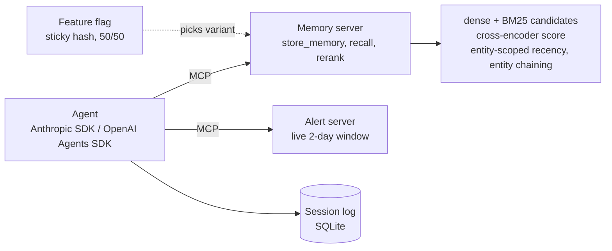

# AgentMem

Long-horizon memory for security-investigation agents. No model training anywhere: retrieval (BM25 + dense), a pretrained
cross-encoder, and entity-aware heuristics decide which records an agent sees. Served over MCP to OpenAI Agents SDK and
Anthropic SDK agents. Includes an evaluation harness for LongMemEval and LoCoMo, a synthetic security-investigation set,
CI gates, and a pre-registered online A/B.

## Results at a glance

| | result | where |
|---|---|---|
| Online A/B, synthetic investigation set, OpenAI-SDK agent (340 sessions, pre-registered) | accuracy **0.621 to 0.797** with the reranker (+0.176, p = 0.0003; question-clustered 95% CI [+0.065, +0.281]) | `results/stage5_ab.md` |
| Same set, Anthropic-SDK agent (85 questions) | 0.894 either way; reranker only trims tool calls (3.06 to 2.69) | `results/stage4_agents.md` |
| Same set, retrieval only (85 questions, held out) | recall@10 0.831 to 0.909, MRR 0.820 to 0.902 | `results/stage3_chain_gated.md` |
| LongMemEval_s and LoCoMo, retrieval only | **negative result for the heuristics**: BM25 fusion and the cross-encoder carry the gains; time-scope, entity and recency signals add nothing measurable | `results/stage2_ce.md`, `results/baselines.md` |

Read these with the limits in mind: the domain data is synthetic and templated, domain results are in-distribution, each
agent is one cheap model, and there are no answer-accuracy numbers on the public benchmarks. The Status section below
lists every caveat, bug and post-hoc decision.

## Architecture



## Use as a library

```python
from agentmem import Memory

mem = Memory("memories.db")                    # SQLite file, or ":memory:"
mem.add("Host web-12 role set to production web server", entities=["web-12"])
for hit in mem.recall("What is the current role of web-12?", k=5):
    print(hit.rank, hit.time, hit.text)
```

Install from a checkout (not on PyPI): `pip install .` for the light core, or `pip install ".[dense]"` for the evaluated
pipeline (bge-small dense retrieval + bge-reranker-base cross-encoder). Extras: `dense`, `mcp` (the MCP servers,
console script `agentmem-mcp`), `agents` (OpenAI Agents SDK and Anthropic SDK), `all`.

- **Light core:** only NumPy is required. `import agentmem` loads no model libraries. Without the `dense` extra it falls
  back to a lexical hashing embedding and no cross-encoder, and warns that quality is lower.
- **Bring your own models:** `Memory(embedder=fn, scorer=fn)`. `embedder(texts) -> (n, d)` array replaces the dense
  model; `scorer([(query, text), ...]) -> list[float]` replaces the cross-encoder. The scorer is one signal in a weighted
  blend with dense and BM25 scores, not an override.
- **Config:** `Config(weights=..., chain=..., dense_model=..., reranker_model=...)`. Defaults are the values evaluated in
  this repo (tuned on LongMemEval_s and a sibling synthetic set); re-tune on your own questions.
- **Agents:** `agentmem.adapters.anthropic_tools(mem)` returns `(tool_definitions, handle)`;
  `openai_agents_tools(mem)` returns Agents SDK function tools. Both expose `memory_recall` and `memory_store`.
- **Time:** `Memory(now=...)` fixes the clock to replay a historical store; memories newer than the clock are not
  recalled. `recall(start=..., end=...)` filters by date (date-granular, UTC).
- **No surprise files:** nothing is written to your working directory. A file-backed store keeps its embedding cache
  next to the database (`<path>.emb.sqlite`).

Known limits of the package as it stands:
- **Scale.** BM25 statistics are recomputed over the store on every query, so recall time grows linearly with the number
  of memories. It was only measured at about 3,000 memories (median 212 ms per recall with the cross-encoder, 14 ms
  without, on a laptop CPU). Do not expect it to hold up at 100,000 memories without an incremental index.
- **Evidence.** The gains reported here come from one synthetic investigation set plus a benchmark result where the
  cross-encoder and BM25 fusion did the work. Treat the defaults as a starting point.
- **Packaging.** The wheel also contains the research and evaluation modules (`bench`, `spike`, `domain`, ...). The stable
  API is only what `agentmem` exports (`Memory`, `Hit`, `Config`) plus `agentmem.adapters`; everything else may change.

## License

MIT, see `LICENSE`.

## Problem

As an agent's history grows over days and weeks, recency or embedding-similarity retrieval surfaces the wrong memories. The reranker's job is to pick the memories that change the agent's next decision.

## Memory schema (fixed)

One atomic record per memory (`agentmem/schema.py`):

| field | meaning |
|---|---|
| `id` | stable id; for benchmarks this matches the gold-evidence id (LoCoMo `dia_id`, LongMemEval `session:turn`) |
| `text` | the content |
| `timestamp` | epoch seconds |
| `source` | `user_message`, `assistant_message`, `tool_call`, `agent_note` |
| `entities` | entity tags (hosts, users, IPs, ticket IDs, people, places) |
| `importance` | write-time prior in [0, 1] (agent-flagged decisions, confirmed facts) |

## Baselines

1. `recency`: newest first
2. `bm25`: lexical
3. `dense`: bge-small-en-v1.5 top-k (falls back to a hashing embedding when `sentence-transformers` is absent; the table says which backend ran)
4. `crossencoder`: dense top-50 reranked by bge-reranker-base
5. Context compression (summarize-then-retrieve): not implemented yet, see Status

## Metrics

- Retrieval: recall@k and MRR of gold evidence ids, with bootstrap 95% CIs over questions, broken down by question type.
- Answer quality (optional, costs money): token F1 against the gold answer. The LongMemEval LLM-judge is not wired in yet.
- LongMemEval types: single-session, multi-session, temporal reasoning, knowledge update, abstention. LoCoMo: per-category breakdown.
- Rule: tune on LongMemEval_s only; LoCoMo is held out.

## Budget

Every API dollar goes in `COSTS.md`. All model calls are cached on disk under `.cache/` keyed by prompt hash. Retrieval-only runs cost nothing.

## Usage

```bash
make test                                   # all test modules
make bench DATASET=toy RETRIEVER=bm25
make bench DATASET=longmemeval DATA=path/to/longmemeval_s.json RETRIEVER=dense
make bench DATASET=locomo DATA=path/to/locomo10.json RETRIEVER=bm25
```

Results land in `results/<dataset>_<retriever>.md`.

## Status

- Stage 0: done (this file)
- Stage 1: harness, schema, cache, loaders, four baselines, metrics. Loaders verified on the real `locomo10.json` (1986 questions) and `longmemeval_s_cleaned.json` (500 questions, from `xiaowu0162/longmemeval-cleaned`). All four baselines on both datasets are in `results/baselines.md`.
- LongMemEval_s dense/crossencoder numbers are being regenerated after a same-day date bug fix (see the correction note in `results/baselines.md`); earlier claims about temporal-reasoning being the weakest category were an artifact of that bug.
- Stage 2 spike (`results/stage2_spike.md`, `results/stage2_ce.md`): BM25+dense fusion and a cross-encoder score carry the gains; the time-scope, entity and recency heuristics add nothing measurable, and the tuned combination does not beat the cross-encoder alone. LoCoMo numbers in `stage2_ce.md` are a every-4th-question subsample (497 questions).
- LLM time-scope parse (`results/stage2_llmscope.md`): a cheap-model parser roughly doubles scope coverage (to ~12-14% of questions) but does not improve retrieval; only ~58% of scoped questions have a gold turn inside the window, because session timestamps do not line up with when the described events happened. Rejected.
- Stage 3: synthetic security-investigation set (`datasets/securitydomain/`, regenerate with `python -m agentmem.domain`): 3069 records over 4 weeks, 12 planted multi-step incidents, 85 questions with exact ground truth (single-hop, multi-hop, temporal, knowledge-update, abstention). Templated text, no LLM or API use. Baselines in `results/stage3_baselines.md`, Stage 2 configs in `results/stage3_rerank.md`.
- Stage 3 finding: every method finds only one of the two records for each multi-hop question (recall 0.50), the latest version of an updated fact ranks poorly (knowledge-update MRR 0.4-0.7), and the Stage 2 heuristics, frozen from LongMemEval, add nothing over the cross-encoder. Entity chaining and entity-scoped recency (`agentmem/chain.py`) address both: on the held-out seed-7 domain set, recall@10 0.831 to 0.909 (multi-hop 0.50 to 0.80) and MRR 0.820 to 0.902 (knowledge-update 0.57 to ~0.92). Parameters were tuned only on a second synthetic set (seed 11, same generator, so in-distribution). On LoCoMo and LongMemEval_s the update bonus must be gated on a recency cue (`results/stage3_chain_gated.md`): the ungated version tuned on the domain set cut LongMemEval MRR from 0.724 to 0.662 (`results/stage3_chain.md`). Gating was chosen after seeing that result. Chaining costs about 0.016 MRR on LongMemEval (within noise). Some multi-hop questions have benign look-alike records (approved backup transfers) as plausible competing answers.
- Stage 4: the pipeline as MCP services (`agentmem/mcp_memory.py`: `store_memory`, `recall`, `rerank`, SQLite-backed; `agentmem/mcp_alerts.py`: `search_alerts`, `get_host`, `get_user`, `open_ticket_history` over a 2-day live window, so older history is only reachable through memory). `AGENTMEM_RERANK=off|on` switches variant A (dense top-k) and B (full reranker). Sending every domain question through the real MCP `recall` tool gives A recall@10 0.714 / MRR 0.717 and B 0.909 / 0.902, matching the offline pipeline (`results/stage4_mcp_recall.md`; no LLM involved).
- Stage 4 agent results (`results/stage4_agents.md`, 85 domain questions, single run per cell, graded deterministically): the Anthropic-SDK agent (claude-haiku-5-5) scores 0.894 with the reranker off and on (paired difference 0.000, 95% CI [-0.047, +0.047]); the reranker only trims tool calls (3.06 to 2.69 per question). The OpenAI-Agents-SDK agent (gpt-4o-mini) goes 0.624 to 0.776 (paired +0.153, CI [+0.071, +0.247]; 14 questions fixed, 1 broken), mostly multi-hop (0.20 to 0.55) and single-hop (0.83 to 1.00). The stronger agent compensates for weaker retrieval by calling `recall` about twice per question; the weaker one issues about 1.1. Cross-agent differences mix model and framework. Remaining misses are mostly multi-hop and temporal, partly because some questions have benign look-alike records as plausible competing answers.
- Stage 4 incident, for transparency: a first OpenAI reranker-on run hit a thread-safety bug in the memory server (SQLite connection shared across MCP worker threads). The OpenAI SDK hands tool errors to the model as text, so they were scored as misses. Fixed with locks, a regression test, per-call error flags, and an abort after 3 consecutive tool-error rows; both OpenAI runs were redone. Anthropic runs were unaffected (a tool error would have crashed them). Agent spend is unmetered (see `COSTS.md`).
- Stage 5 online A/B (`ab/PREREG.md` committed before the run; `results/stage5_ab.md`): 340 synthetic sessions on the OpenAI-SDK agent, variant assigned by a sticky hash-based flag. Reranker B 0.797 vs dense top-k A 0.621 (+0.176, z = 3.58, p = 0.0003; question-clustered bootstrap 95% CI [+0.065, +0.281]); the pre-registered rule says promote B. Gains are in multi-hop (0.14 to 0.54), temporal (0.37 to 0.57) and single-hop (0.89 to 1.00). B's sessions are slower (4.0 s vs 2.2 s mean) and use the same tokens and tool calls. Caveats: synthetic in-distribution data, one model, 84 distinct questions repeated, an uneven 153/187 split, and no Langfuse (local SQLite sink instead).
- Stage 5 gates and guardrails (details and caveats in `results/stage5_guardrails.md`):
  - Recall gate (`python -m agentmem.gate_recall`, `make gate`): 30 fixed domain questions through the full pipeline, no API key. Baseline recall@10 0.967 / MRR 1.0 (`ci/recall_baseline.json`); fails on a drop of more than 0.03 or recall under 0.80. Shown to fail: the dense-only pipeline scores 0.717 / 0.747 and trips all three checks.
  - Answer gate (`ci/promptfooconfig.yaml`, promptfoo, 20 fixed questions the agent already answers correctly, repo grader as the assertion, 90% pass rate): 20/20 locally. A regression detector, not an accuracy estimate.
  - GitHub Actions workflow (`.github/workflows/gates.yml`): one manual run on GitHub (workflow_dispatch) was green: unit tests and the recall gate passed on Linux CPU, and the answer gate skipped itself because the `ANTHROPIC_API_KEY` repository secret is not set. Not yet exercised: the `pull_request` trigger, a PR that the gate actually blocks, and the answer gate running on GitHub.
  - Guardrails: the rule-based topical rail is weak on held-out prompts (recall 0.53, 3/30 benign wrongly blocked), Llama Guard 3 is implemented but untested against a real model (no Ollama), NeMo Guardrails wiring works without an LLM (`nemo_rails/`).
  - Not done: Langfuse (needs an account; sessions go to local SQLite), and the guardrails are not yet wired into the agent runners.
- The answer grader was changed once after seeing the 5-question smoke test (exact phrases to stemmed clause words), because correct rephrasings were scored wrong; all four runs are graded by the final version.
- Gold evidence is turn-level (`has_answer` for LongMemEval, `evidence` dia_ids for LoCoMo). LongMemEval abstention questions have no gold and are excluded from retrieval metrics.
- Not yet: compression baseline, LLM-judge scoring, answer-accuracy numbers (need the paid answerer), reranker (Stage 2), domain data (Stage 3).
- Data lives in `data/` (git-ignored; re-download from the sources above).
